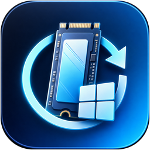

<p align="center">
  
</p>

<h1 align="center">SWBI — Self Windows Bootable Installer</h1>

<p align="center">
  <strong>Install, Clean-Reinstall, Upgrade, or Downgrade ("Degrade") Windows 10 &amp; Windows 11 directly from your internal <code>C:</code> drive — 100% USB-free, pendrive-free, and self-contained.</strong>
</p>

<p align="center">
  <a href="https://github.com/MrPcGamerYT/Windows-self-bootable/releases/latest"></a>
  <a href="https://github.com/MrPcGamerYT/Windows-self-bootable/actions"></a>
  
  
  <a href="LICENSE"></a>
</p>

---

## Table of Contents

1. [What Is SWBI & Why Does It Exist?](#1-what-is-swbi--why-does-it-exist)
2. [Download — Which `.exe` Should I Choose?](#2-download--which-exe-should-i-choose)
3. [Supported Windows Versions, ISOs, Drives & PC Types](#3-supported-windows-versions-isos-drives--pc-types)
4. [Complete Step-by-Step User Guide (How to Use SWBI)](#4-complete-step-by-step-user-guide-how-to-use-swbi)
   - [Before You Start (2-Minute Checklist)](#before-you-start-2-minute-checklist)
   - [Phase 1 — Prepare Your PC Inside Current Windows (Steps 1–5)](#phase-1--prepare-your-pc-inside-current-windows-steps-15)
   - [Phase 2 — Install Windows After Restart (Inside Windows Setup)](#phase-2--install-windows-after-restart-inside-windows-setup)
   - [Phase 3 — Post-Install Cleanup & Reclaim Space](#phase-3--post-install-cleanup--reclaim-space)
5. [Special Guides (Win10 → Win11, Downgrade Win11 → Win10, 32-Bit → 64-Bit, Custom ISOs)](#5-special-guides-win10--win11-downgrade-win11--win10-32-bit--64-bit-custom-isos)
6. [How SWBI Works Under the Hood (Full Technical Breakdown)](#6-how-swbi-works-under-the-hood-full-technical-breakdown)
   - [End-to-End Lifecycle Diagram](#end-to-end-lifecycle-diagram)
   - [The 7-Stage Preparation Pipeline](#the-7-stage-preparation-pipeline)
   - [Deep-Dive Engineering Subsystems](#deep-dive-engineering-subsystems)
7. [Where SWBI Appears Across Menus & Choosers](#7-where-swbi-appears-across-menus--choosers)
8. [Safety Architecture, Recovery & Troubleshooting FAQ](#8-safety-architecture-recovery--troubleshooting-faq)
9. [Command-Line Options, Building from Source & Automated Testing](#9-command-line-options-building-from-source--automated-testing)

---

## 1. What Is SWBI & Why Does It Exist?

Normally, doing a **true clean Windows installation**, **downgrading from Windows 11 back to Windows 10**, **switching from 32-bit to 64-bit Windows**, or **escaping a corrupted/broken Windows OS** requires a physical 8 GB+ USB flash drive and another working tool like Rufus or Media Creation Tool. Running `setup.exe` directly from a mounted ISO inside Windows cannot format `C:`, cannot downgrade builds while wiping partitions cleanly, and fails completely on cross-architecture (`32-bit → 64-bit`) or damaged Windows installs.

**SWBI (`Self Windows Bootable Installer`)** attempts this using a temporary partition, including on systems with only `C:`. Firmware and storage behavior varies; preparation or boot may fail.

> **Data-safety warning:** Back up important files and save the BitLocker recovery key before live operation. Have independent Windows recovery/installation media available. Online partition changes and firmware writes are not atomic, and power loss or failed cleanup can require manual recovery. Validate this version in a disposable Windows VM before using it on important hardware.


1. **Creates a Dedicated Internal Boot Partition:** Attempts to shrink the tail end of `C:` online and then formats a temporary **FAT32** installer partition labeled **`SWBI-SETUP`**.
2. **Deploys Any Official or Custom Windows 10 / 11 ISO:** Streams files directly out of your `.iso` in pure C# (no fragile Virtual DVD drive letters required) and automatically splits large `> 4 GB` `install.wim` / `install.esd` images into FAT32-compatible `.swm` chunks (`install.swm`, `install2.swm`, …) so **UEFI Secure Boot** works natively.
3. **Protects Your Hardware Drivers Automatically:** Harvests your PC's active **NVMe / Intel VMD / Intel RST / RAID / SATA storage drivers** and **Wi-Fi / Ethernet network drivers**, placing them into `$WinPEDriver$`, a visible folder on `SWBI-SETUP`, and `sources\boot.wim` — preventing the notorious *"We couldn't find any drives"* error during setup.
4. **Requests a One-Time Setup Boot:** On UEFI, registers an installer-local EFI loader with firmware `BootNext`; on legacy BIOS, uses a backed-up Windows Boot Manager BCD and `{bootmgr}\bootsequence`. It does not arm both paths at once or replace the host ESP boot manager. Actual boot behavior depends on firmware and the installer media.
5. **100% Self-Contained (Zero Reliance on Built-In Windows Tools):** Every disk, NTFS shrink, FAT32 format, ISO/UDF parse, WIM/SWM split, registry hive mount, and UEFI/BCD operation runs **in-process via pure C# and direct Win32/NT kernel IOCTLs** — so SWBI still works even when your current Windows installation is heavily stripped, modded, or corrupted (`diskpart`, `bcdedit`, `dism`, `powershell`, `format.com`, and `%TEMP%` are never required).
6. **One-Click Post-Install Space Reclamation:** Once your fresh Windows desktop opens, launch SWBI again, switch to **`2. Post-Install Cleanup`**, and click one button to remove the temporary `SWBI-SETUP` partition and, when the freed space is adjacent and compatible, extend `C:` into it.

---

## 2. Download — Which `.exe` Should I Choose?

Download the latest standalone `.exe` directly from **[GitHub Releases](https://github.com/MrPcGamerYT/Windows-self-bootable/releases/latest)** — **no `.zip` extraction and no installation required**. Just download and run!

| Release File | Target PC | Size | When to Use This File |
|---|---|---|---|
| **`SWBI-SelfWindowsBootableInstaller-vX.Y.Z-win-x64-standalone.exe`** | **64-bit Intel / AMD (`x64`)** | ~67 MB | **Recommended for 95% of PCs.** Bundles the entire .NET 8 + WPF runtime inside a single `.exe` — runs out-of-the-box even on fresh, stripped, or broken 64-bit Windows 10 & 11 systems. |
| **`SWBI-SelfWindowsBootableInstaller-vX.Y.Z-win-x86-32bit.exe`** | **32-bit Intel / AMD (`x86`)** | ~62 MB | Use when your **currently running** Windows is **32-bit (`x86`)** — whether reinstalling 32-bit Windows 10 **or** upgrading a 64-bit-capable PC from **32-bit Windows → 64-bit Windows 10/11** without a USB stick! |
| **`SWBI-SelfWindowsBootableInstaller-vX.Y.Z-win-arm64-standalone.exe`** | **ARM64 (`Snapdragon / Surface / Windows on ARM`)** | ~63 MB | Native single-file standalone `.exe` for ARM64 Windows 10 & Windows 11 laptops/tablets (`bootaa64.efi`). |
| **`SWBI-SelfWindowsBootableInstaller-vX.Y.Z-win-x64-lightweight.exe`** | **64-bit Intel / AMD (`x64`)** | ~0.9 MB | Ultra-small download for 64-bit Windows PCs that already have the **.NET 8 Desktop Runtime (x64)** installed. |

> **Tip:** To check whether your current Windows is 64-bit, 32-bit, or ARM64, press **`Win + Pause`** (or open **Settings → System → About**) and check **System type**. When in doubt on an Intel/AMD PC, download **`win-x64-standalone.exe`**.

---

## 3. Supported Windows Versions, ISOs, Drives & PC Types

### Operating System & Architecture Support Matrix

| Current Running OS | Target ISO You Want to Install | Supported? | Notes |
|---|---|---|---|
| **Windows 10 / 11 (`64-bit x64`)** | **Windows 10 or Windows 11 (`64-bit x64`)** | **Yes — Full** | Clean Install, Upgrade (`Win10 → Win11` or `23H2 → 24H2`), In-Place Upgrade, and Clean Downgrade (`Win11 → Win10`) + optional Win11 TPM/CPU/RAM bypass. |
| **Windows 10 (`32-bit x86`)** | **Windows 10 (`32-bit x86`)** | **Yes — Full** | Run `win-x86-32bit.exe`. Supports both Legacy BIOS (`bootmgr`) and 32-bit IA32 UEFI (`bootia32.efi`). |
| **Windows 10 (`32-bit x86`) on a 64-bit CPU** | **Windows 10 or Windows 11 (`64-bit x64`)** | **Yes — USB-Free `32-bit → 64-bit`!** | Run `win-x86-32bit.exe`. SWBI verifies 64-bit CPU Long Mode via `CPUID`, builds the 64-bit `SWBI-SETUP` partition, and boots directly into 64-bit Windows Setup (bypassing Windows' block on launching 64-bit `setup.exe` inside 32-bit Windows). |
| **Windows 10 / 11 (`ARM64`)** | **Windows 10 or Windows 11 (`ARM64`)** | **Yes — Full** | Run `win-arm64-standalone.exe`. Configures native `bootaa64.efi` WinPE boot. |
| **Any PC** | **Windows 11 (`32-bit x86`)** | *N/A (No Win11 x86 exists)* | Microsoft never produced a 32-bit (`x86`) Windows 11. On 32-bit-only CPUs use **Windows 10 32-bit**; on older 64-bit CPUs without TPM 2.0 use **64-bit Windows 11** with SWBI's automatic hardware bypass. |

### Supported ISO Types
- **Official Microsoft ISOs:** Windows 10 (all releases through 22H2, LTSC, Enterprise, Education, Home/Pro) & Windows 11 (21H2, 22H2, 23H2, 24H2+, LTSC), Media Creation Tool (`install.esd` & dual-architecture `x86+x64`) ISOs, and UUPdump ISOs.
- **Custom, Modded, Lite & AIO ISOs:** Tiny10, Tiny11, AtlasOS, ReviOS, Ghost Spectre, NTLite, WinReducer, and custom sysprepped WIM/ESD builds. SWBI preserves custom `autounattend.xml`, `$OEM$`, and `ei.cfg` files, and even synthesizes missing `\boot\boot.sdi` or standalone EFI bootloaders if a stripped ISO omitted them.

### Supported `C:` Drives & Partition Styles
- **All Internal Storage Types:** NVMe M.2 PCIe SSDs (Gen3/Gen4/Gen5), SATA/AHCI 2.5" SSDs, Mechanical HDDs (5400/7200 RPM), Intel VMD / Intel RST / AMD RAID arrays, eMMC / UFS compact laptop storage, and Virtual Machines (Hyper-V, VMware, VirtualBox, QEMU/VirtIO), across `512`, `512e`, and `4Kn` native sector geometries.
- **GPT + UEFI (with or without Secure Boot):** Full native FAT32 + Microsoft-signed `bootmgfw.efi` support — **you do NOT need to disable Secure Boot** for official Windows ISOs.
- **MBR + Legacy BIOS / CSM:** Full smart MBR support — handles both **two-partition (`System Reserved` + `C:`)** and **single-partition (Active `C:`)** layouts, Extended/Logical (`D:`, `E:`) partitions, and even **Windows 11 on Legacy BIOS + MBR** (via automatic `LabConfig` check bypass).

---

## 4. Complete Step-by-Step User Guide (How to Use SWBI)

### Before You Start (2-Minute Checklist)

1. **Back up important personal files** from `C:` (Documents, Desktop, Photos, browser data) to external storage or cloud storage before any live operation, whether or not you plan to wipe/format `C:`. *(Note: Copy your downloaded **`SWBI-...exe`** onto a secondary drive or cloud/phone, or simply re-download it after your new Windows boots so you can run Post-Install Cleanup!)*
2. **Have a Windows 10 or Windows 11 `.iso` file** saved anywhere on your PC (for example in `C:\Downloads\Win11_24H2.iso`).
3. **Ensure enough free space on `C:`:** Typically **16 GB – 20 GB+ of free space** on `C:` (8 GB–10 GB temporary `SWBI-SETUP` partition + an enforced **8 GB safety reserve** so your current Windows never runs out of disk space).
4. **Plug in your laptop charger** so power cannot drop during partitioning or reboot.

---

### Phase 1 — Prepare Your PC Inside Current Windows (Steps 1–5)

Double-click your downloaded **`SWBI-SelfWindowsBootableInstaller-...exe`** and click **Yes** on the Windows UAC Administrator prompt.

> **Important Note About Dry-Run Safety Mode:**
> For your protection, SWBI starts with **`Dry-Run Safety Mode` checked** in the top bar.
> - Leave **`Dry-Run Safety Mode` checked** if you want to test and preview the entire 5-step wizard first without touching your disk!
> - **Uncheck `Dry-Run Safety Mode`** in the top bar when you are ready for SWBI to actually create the bootable partition on your PC.

#### Step 1 • PC & Drive Scan (`1. Prepare Installer` Tab)
- SWBI automatically scans your CPU architecture, RAM, firmware mode (`UEFI` vs `Legacy BIOS`), `TPM 2.0`, `Secure Boot`, BitLocker status, `C:` drive hardware type (`NVMe SSD`, `SATA SSD`, `HDD`, `RAID/VMD`), partition style (`GPT` or `MBR`), and exact shrinkable space on `C:`.
- Review the **Safety, Compatibility & Drive Readiness Checks** list:
  - **Green (`PASS`) / Blue (`INFO`):** Ready to go.
  - **Yellow (`WARN`):** Handled automatically or requires a simple acknowledgment checkbox in Step 4 (such as BitLocker or unsupported Win11 CPU).
  - **Red (`BLOCK`):** Explains the exact issue and gives a clear one-line fix (e.g., freeing space on `C:`).
- Click **`Next Step →`**.

#### Step 2 • ISO & Smart Mode
1. Click **`Browse ISO...`**, pick your Windows 10 or Windows 11 `.iso` file, and click **`Inspect & Analyze`**.
2. Within seconds (mounted directly in memory with zero Virtual DVD drive needed), SWBI displays every Windows edition inside the ISO (`Home`, `Pro`, `Education`, `LTSC`, etc.), image size, and whether `.swm` splitting is needed.
3. Review the **Smart Hardware & Edition Compatibility Automation** options (SWBI automatically pre-selects the ideal settings for your exact PC!):
   - **Preferred Installation Workflow:**
     - *SWBI Self-Bootable Clean Install / Upgrade / Downgrade* *(Default — boots into standalone WinPE so you can format/wipe old `C:` or install alongside `Windows.old`)*
     - *In-Place Upgrade (Keep Apps, Files & Settings)* *(Available when upgrading to an equal/newer build while also keeping `SWBI-SETUP` ready as rescue media)*
   - **Export active Storage & Network drivers** *(Keep checked — saves your NVMe/VMD/SATA + Wi-Fi/Ethernet drivers onto `SWBI-SETUP`!)*
   - **Inject boot-critical Storage Controller drivers into `boot.wim`** *(Keep checked on Intel VMD/RST laptops or Win11 → Win10 downgrades!)*
   - **Generate `sources\ei.cfg` Edition Unlock** *(Lets you pick `Home` vs `Pro` freely during setup even on OEM motherboards)*
   - **Bypass Windows 11 Hardware Requirements (`LabConfig`)** *(Automatically checked if installing Windows 11 on a PC without TPM 2.0, Secure Boot, or an official Win11 CPU)*
4. Click **`Next Step →`**.

#### Step 3 • Partition Cheat Sheet
- SWBI shows two side-by-side visual partition maps:
  1. **After Preparation (Before Reboot):** How your disk looks once `C:` is shrunk and `SWBI-SETUP` is added at the end.
  2. **Inside Windows Setup:** Exactly which partition to **KEEP**, which partition to **DELETE or FORMAT**, and where **`SWBI-SETUP`** sits.
- **Take a quick phone photo** of the **Windows Setup Partition Cheat Sheet** table (or click **`Save Cheat Sheet (.txt)`**). Remember: inside Windows Setup, drive letters (`C:`, `D:`, `E:`) can shift — **always identify partitions by their Size (GB) and Label (`SWBI-SETUP`)!**
- Click **`Next Step →`**.

#### Step 4 • Prepare & Drivers
1. Uncheck **`Dry-Run Safety Mode`** (either right inside Step 4 or in the top header) when you are ready to prepare your disk for real.
2. Check the mandatory **Data-Safety Confirmation** boxes:
   - You backed up important personal files.
   - You understand deleting/formatting old `C:` erases that partition.
   - You will **NOT** delete or format **`SWBI-SETUP`** or the **`EFI System Partition`** during Windows Setup.
   - *(If BitLocker / Device Encryption is active on `C:`)* Confirm you saved your 48-digit BitLocker Recovery Key and leave **Automatically suspend BitLocker protection on C: for 1 reboot cycle** checked.
3. Click **`Build 'SWBI-SETUP' & Arm SWBI Boot`** (Live Mode).
4. Watch the live 7-step progress bar as SWBI:
   - Shrinks `C:` online and silently creates/formats `SWBI-SETUP` (`FAT32`) **with zero Explorer "Format Disk" popups**,
   - Extracts your ISO & splits any `> 4 GB` image into verified `.swm` files,
   - Exports & injects your PC's storage and Wi-Fi/LAN drivers,
   - Verifies every boot file and WIM/SWM header, and
   - Arms **`SWBI - Self Windows Bootable Installer`** for your next restart.

#### Step 5 • Reboot & Install
- Once preparation reaches **100%**, SWBI automatically opens **Step 5 — SWBI Self-Bootable Windows Installer Ready**.
- Click the red **`Restart Now into SWBI - Self Windows Bootable Installer`** button!

---

### Phase 2 — Install Windows After Restart (Inside Windows Setup)

1. **Requested Boot Into SWBI:**
   - The next restart requests the installer through UEFI `BootNext` or the legacy BCD boot sequence. Firmware can ignore or remove entries, and the installer may not boot.
   - On UEFI, the temporary entry may also be available in your motherboard's boot menu (`F12`, `F11`, `F8`, `F9`, or `Esc`). If it is not, use independent recovery media rather than assuming the existing OS will boot.

2. **Follow the Initial Setup Screens:**
   - Choose your Language/Keyboard → click **Next** → **Install now**.
   - Select your desired Windows edition (e.g., *Windows 11 Pro* or *Windows 10 Pro*) → accept license terms → choose **Custom: Install Windows only (advanced)**.

3. **CRITICAL — Choosing the Right Partition on *"Where do you want to install Windows?"*:**

   Look at your partition list carefully and match it to your Cheat Sheet from Step 3:

   #### Case A: Modern GPT + UEFI PC (Most PCs)
   ```text
   Drive 0 Partition 1: System (EFI, ~100–260 MB)     --> KEEP (DO NOT TOUCH)
   Drive 0 Partition 2: MSR (Reserved, ~16 MB)        --> KEEP (DO NOT TOUCH)
   Drive 0 Partition 3: Primary (Your shrunk old C:)  --> DELETE THIS ONE (or select without deleting to keep Windows.old)
   Drive 0 Partition 4: SWBI-SETUP (~8–12 GB, FAT32)  --> NEVER DELETE OR FORMAT! (This IS your installer!)
   ```
   - For a **100% Clean Install**: Select **only** your shrunk old Windows partition (plus the tiny ~500–800 MB old WinRE Recovery partition if immediately next to it), click **Delete**, then select the resulting **Drive 0 Unallocated Space** and click **Next**!
   - For **Keeping `C:\Windows.old`** ( keeps old files inside `C:\Windows.old`): Select your shrunk old Windows partition **without** clicking Delete or Format, and click **Next**.

   #### Case B: Legacy BIOS + MBR PC with a Single Active `C:` Partition
   ```text
   Drive 0 Partition 1: Primary (Your shrunk old C:, System/Active) --> CLICK "FORMAT" (DO NOT CLICK DELETE!)
   Drive 0 Partition 2: SWBI-SETUP (~8–12 GB, FAT32)                --> NEVER DELETE OR FORMAT!
   ```
   - If your MBR disk has no separate `System Reserved` partition (meaning `C:` holds the Active `0x80` boot flag), click **Format** on `Partition 1` (do **not** click Delete, so the Active boot flag stays intact), then keep `Partition 1` selected and click **Next**!

4. **Need a Storage or Wi-Fi Driver Manually? (Usually Automatic!)**
   - SWBI already auto-loads drivers from `SWBI-SETUP\$WinPEDriver$` and `boot.wim`.
   - If you ever want to load a driver manually during Setup, click **Load driver → Browse → `SWBI-SETUP` → `SWBI - Self Windows Bootable Installer Drivers` → `Storage`** (or after Windows boots, open **`Network`** in Device Manager to install Wi-Fi immediately offline!).

5. **Let Windows Finish Installing:**
   - Windows copies files from `SWBI-SETUP` and restarts during installation. The boot request is one-time, but firmware and Windows Setup behavior varies; be prepared to select the appropriate boot device or use recovery media.

---

### Phase 3 — Post-Install Cleanup & Reclaim Space

Once your new Windows installation reaches the Desktop and boots normally on its own:

1. Launch **`SWBI-SelfWindowsBootableInstaller-...exe`** as Administrator *(or run `SWBI-SelfWindowsBootableInstaller.exe --cleanup`)*.
2. Click **`2. Post-Install Cleanup`** in the top navigation bar (and make sure **`Dry-Run Safety Mode`** is **unchecked**).
3. Click **`Inspect Post-Install State`** (SWBI verifies you are booted into your real Windows OS, confirms `SWBI-SETUP`'s cryptographic manifest / partition GUID, and checks right-side adjacency to `C:`).
4. Ensure both checkboxes are checked:
   - **`Automatically extend C: into reclaimed space`**
   - **`I confirm my new Windows installation boots normally into the desktop without needing SWBI Setup.`**
5. Click **`Remove SWBI Boot Entries & Reclaim Partition`**.
6. In **2–5 seconds**, SWBI:
   - Removes the recorded temporary firmware or legacy BCD entry,
   - Deletes the temporary `SWBI-SETUP` partition, and
   - Attempts to extend `C:` into the reclaimed space when the layout permits it.

---

## 5. Special Guides (Win10 → Win11, Downgrade Win11 → Win10, 32-Bit → 64-Bit, Custom ISOs)

### Upgrading Windows 10 → Windows 11 (Supported & Unsupported PCs)
- Select any Windows 11 ISO in **Step 2**.
- **On Unsupported PCs (No TPM 2.0, older Intel 6th/7th-gen or Ryzen 1000 CPU, Legacy MBR, or 4 GB RAM):** SWBI automatically enables **`Bypass Windows 11 Hardware Requirements in Setup (LabConfig)`**, injecting `BypassTPMCheck`, `BypassSecureBootCheck`, `BypassCPUCheck`, `BypassRAMCheck`, and `BypassStorageCheck` into both WinPE `boot.wim` and `AutoUnattend.xml`.
- **Installer-local UEFI boot:** SWBI points firmware at the installer's architecture-specific EFI loader and leaves the host ESP boot manager and standalone installer BCD unchanged. This avoids replacing host boot files but does not guarantee that firmware or Secure Boot will accept the media.

### Downgrading ("Degrading") Windows 11 → Windows 10 Without USB
- Microsoft blocks keeping apps when downgrading to an older OS build (`setup.exe` grays out options when run inside Windows 11).
- Select your Windows 10 ISO in **Step 2**: SWBI detects **`DOWNGRADE (DEGRADE)`** mode automatically, exports your modern laptop's **NVMe / Intel VMD storage + Wi-Fi drivers** (critical because Windows 10's inbox ISO lacks newer Intel 11th–14th Gen VMD and Wi-Fi 6E/7 drivers!), unlocks editions via `ei.cfg`, and boots into standalone WinPE so you can clean-install Windows 10 effortlessly.

### Upgrading 32-Bit (`x86`) Windows 10 → 64-Bit (`x64`) Windows 10 / 11 Without USB
- Inside 32-bit Windows, Microsoft blocks running 64-bit `setup.exe` (`"This app can't run on your PC"`).
- Download and run **`SWBI-SelfWindowsBootableInstaller-vX.Y.Z-win-x86-32bit.exe`** on your 32-bit Windows PC and select a **64-bit (`x64`)** Windows 10 or Windows 11 ISO.
- SWBI executes a hardware `CPUID` (`0x80000001` Long Mode) check to confirm your CPU supports 64-bit, builds the 64-bit `SWBI-SETUP` partition, and boots straight into 64-bit WinPE at restart!

### Installing Custom / Modded / Lite ISOs (Tiny11, AtlasOS, Ghost Spectre, ReviOS)
- Simply select the custom `.iso` in **Step 2** — SWBI never rejects non-Microsoft hashes, preserves custom answer files (`autounattend.xml`) and `$OEM$` scripts on `SWBI-SETUP`, supports `.esd`, `.wim`, and `.swm` payloads, and automatically synthesizes `\boot\boot.sdi` or EFI bootloaders from `boot.wim` if the custom ISO stripped them out.

---

## 6. How SWBI Works Under the Hood (Full Technical Breakdown)

### End-to-End Lifecycle Diagram

```text
┌──────────────────────────────────────────────────────────────────────────────────┐
│ 1. INITIAL SINGLE-DRIVE LAYOUT (Inside Existing Windows)                         │
│   [ EFI / System Reserved ] [=============== C: (Windows + Files) ==============]│
└───────────────────────────────────────┬──────────────────────────────────────────┘
                                        │
        SWBI Online NTFS Tail Evacuation + FSCTL_SHRINK_VOLUME
        + MountMgr AutoMount Suppression (Zero Explorer "Format Disk" Popup!)
        + Pure-C# FAT32 Format + ISO Stream / .SWM Split + Driver Harvest + Binary BCD
                                        ▼
┌──────────────────────────────────────────────────────────────────────────────────┐
│ 2. AFTER SWBI PREPARATION (Ready for One-Time Restart)                           │
│   [ EFI / SysRes ] [======== C: (Shrunk Safely) ========] [ SWBI-SETUP (FAT32) ] │
│                                                            ├─ sources\boot.wim   │
│                                                            ├─ sources\install.swm│
│                                                            ├─ $WinPEDriver$\...  │
│                                                            └─ EFI\BOOT\BOOTX64   │
└───────────────────────────────────────┬──────────────────────────────────────────┘
                                        │
        Restart -> UEFI BootNext OR legacy BCD bootsequence (one-time request)
        Installer-local boot files request [SWBI-SETUP]\sources\boot.wim
                                        ▼
┌──────────────────────────────────────────────────────────────────────────────────┐
│ 3. INSIDE WINDOWS SETUP (WinPE Running Entirely in RAM + Reading SWBI-SETUP)     │
│   [ EFI / SysRes ] [======== Unallocated / New C: ======] [ SWBI-SETUP (FAT32) ] │
│                     ▲ Install fresh Windows 10/11 here!    ▲ DO NOT DELETE!      │
└───────────────────────────────────────┬──────────────────────────────────────────┘
                                        │
        New Windows Boots to Desktop -> Run SWBI "2. Post-Install Cleanup"
        Deletes BCD/UEFI Entries + Deletes SWBI-SETUP + Online IOCTL_DISK_GROW_PARTITION
                                        ▼
┌──────────────────────────────────────────────────────────────────────────────────┐
│ 4. EXAMPLE FINAL LAYOUT (if adjacent free space can be reclaimed)                │
│   [ EFI / System Reserved ] [============= New C: (extended) ==================]│
└──────────────────────────────────────────────────────────────────────────────────┘
```

### The 7-Stage Preparation Pipeline (`PreparationOrchestrator`)

| Stage | What Happens Under the Hood | Key Win32 / C# Engines |
|---|---|---|
| **Stage 1** | Re-verifies live disk geometry, sector sizes (`512` / `512e` / `4Kn`), GPT/MBR partition table, shrink boundaries, and **8 GB OS safety reserve**. | `WindowsDiskInspector`, `ReadinessEvaluator`, `Win32StorageInterop` |
| **Stage 2** | Suspends BitLocker protection for 1 reboot cycle if encrypted (`DisableKeyProtectors` / WMI FVE) and runs drive-aware optimization (**SSD/NVMe `FSCTL_FILE_LEVEL_TRIM`** vs **HDD tail cluster consolidation** — never defrags flash media). | `WindowsPartitionService`, `NativeNtfsShrinkEngine` |
| **Stage 3** | Suppresses `MountPointManager` AutoMount (`IOCTL_MOUNTMGR_SET_AUTO_MOUNT`) + sets `GPT_BASIC_DATA_ATTRIBUTE_NO_DRIVE_LETTER` so Windows Explorer **never** pops up *"You need to format the disk in drive E:"*, shrinks `C:` online (`FSCTL_SHRINK_VOLUME`), writes the GPT/MBR entry (`IOCTL_DISK_SET_DRIVE_LAYOUT_EX`), formats `\\?\Volume{guid}` as **FAT32 (`SWBI-SETUP`)**, restores AutoMount, and mounts the installer drive letter. | `NativeNtfsShrinkEngine`, `NativeFat32Formatter`, `MountMgrAutoMountSuppressionScope` |
| **Stage 4** | Streams all files directly from the `.iso` via SWBI's zero-mount C# **UDF + ISO-9660/Joliet** reader; splits any `install.wim` > 4 GB directly into FAT32-safe `3,800 MB` `.swm` parts (`install.swm`, `install2.swm`, …) in pure C# (or converts large `.esd` via ISO-self-hosted `wimgapi.dll`); synthesizes missing `boot\boot.sdi` or EFI loaders; applies `LabConfig` / `ei.cfg` / `swbi.ico` branding. | `NativeIsoReader`, `PureCSharpWimSplitter`, `NativeWimApi`, `WindowsIsoDeploymentService` |
| **Stage 5** | Scans `DriverStore\FileRepository` (with fallback reconstruction from `%SystemRoot%\INF` + `System32\drivers`) for non-inbox OEM `SCSIAdapter`, `HDC`, `System`, and `Net` drivers; exports them to `$WinPEDriver$` + `SWBI - Self Windows Bootable Installer Drivers` and offline-injects boot-critical storage drivers into `sources\boot.wim`. | `NativeDriverStoreScanner`, `WindowsDriverHarvesterService`, `NativeWimApi` |
| **Stage 6** | Performs pre-boot binary verification of `boot\boot.sdi`, `sources\boot.wim`, architecture-matched UEFI/BIOS boot managers (`bootx64.efi`, `bootaa64.efi`, `bootia32.efi`, `bootmgr`), `setup.exe`, and `MSWIM` headers **before** any boot entry is armed. | `WindowsIsoDeploymentService` |
| **Stage 7** | On UEFI, requires a nonempty architecture-named EFI loader and installer-local BCD, then registers `BootXXXX`, `BootOrder` and one-time `BootNext`, with readback. On legacy BIOS, backs up the active system BCD and creates a one-time BCD entry. Neither path modifies the standalone installer BCD. The manifest records the selected path. | `NativeUefiAndBcdRegistryEngine`, `WindowsBcdBootService` |

---

### Deep-Dive Engineering Subsystems

#### 1. 100% Zero-Windows-Tool Self-Contained Engine
SWBI **never spawns** `diskpart.exe`, `bcdedit.exe`, `dism.exe`, `format.com`, `powershell.exe`, `pnputil.exe`, `reg.exe`, `defrag.exe`, `manage-bde.exe`, or `shutdown.exe`. Even if a user's current Windows OS is heavily debloated, corrupted, or missing `System32` command-line utilities, every operation executes natively inside SWBI's own process.

#### 2. Why FAT32 + Pure-C# `.swm` Splitting? (Native UEFI & Secure Boot)
- Every UEFI motherboard includes a built-in **FAT32** filesystem driver in ROM, whereas booting an **NTFS** partition in UEFI requires unsigned/third-party UEFI NTFS drivers that often get blocked by **Secure Boot**.
- However, FAT32 has a strict `4 GiB - 1 byte` per-file ceiling, while modern Windows 10/11 `sources\install.wim` files are `4.5 GB – 7.5 GB`.
- `PureCSharpWimSplitter` parses Microsoft's `MSWIM` container header, resource lookup table, compressed LZX/XPRESS streams, and UTF-16LE XML catalog directly in C#, splitting `install.wim` on-the-fly into `< 3,800 MB` `install.swm`, `install2.swm`, … parts directly onto `SWBI-SETUP` — without staging the WIM on `C:`. Secure Boot acceptance still depends on the media's signatures and firmware policy.

#### 3. Online NTFS Tail Cluster Evacuation & Shrink (`NativeNtfsShrinkEngine`)
- Even when `C:` shows 50 GB free, Windows often scatters unmovable or tail-allocated clusters near the end of the NTFS volume, causing standard shrink tools to fail with `Win32 error 87 (ERROR_INVALID_PARAMETER)`.
- SWBI queries the live NTFS cluster allocation bitmap (`FSCTL_GET_VOLUME_BITMAP`), relocates movable files sitting past the target boundary via `FSCTL_MOVE_FILE`, aligns sector geometry to exact NTFS cluster boundaries (reserving 1 cluster for the NTFS backup boot sector), commits the 24-byte `SHRINK_VOLUME_INFORMATION` (`ShrinkPrepare` → `ShrinkCommit`) via `FSCTL_SHRINK_VOLUME`, and updates the partition table cleanly.

#### 4. Silent Partition Creation Without Explorer Format Popups (`v0.8.2+`)
- Normally, writing a new partition entry to a disk causes Windows `MountPointManager` (`\\.\MountPointManager`) to immediately mount an unformatted drive letter (`E:`), triggering Explorer's alarming *"You need to format the disk in drive E: before you can use it"* dialog.
- SWBI wraps partition creation inside `MountMgrAutoMountSuppressionScope` (`IOCTL_MOUNTMGR_SET_AUTO_MOUNT = Disabled`) and sets `GPT_BASIC_DATA_ATTRIBUTE_NO_DRIVE_LETTER` (`0x8000000000000000`) while formatting `\\?\Volume{guid}` directly via `NativeFat32Formatter`. Only **after** a valid `FAT32` (`SWBI-SETUP`) filesystem is committed on disk does SWBI restore AutoMount, clear `NO_DRIVE_LETTER`, and mount the drive letter cleanly.

#### 5. Firmware-Specific Boot Registration
- UEFI requires a nonempty installer-local, architecture-named EFI loader and BCD, then requests a single firmware `BootNext` entry. These checks do not establish signature validity or bootability. It does not replace the host ESP's boot manager or arm a host BCD boot sequence.
- Legacy BIOS requires a successful backup of the already-loaded system BCD before creating ramdisk entries and a one-time `{bootmgr}\bootsequence`. Existing pending one-time entries are not overwritten.
- Registration checks reads and writes, attempts ownership-limited cleanup on errors, and preserves the installer partition if boot cleanup cannot be confirmed. Firmware variables and BCD operations are not transactional; recovery may be necessary.

#### 6. `%TEMP%` & `ZLAG~1`-Immune Native Win32 Self-Extracting `.exe` Wrapper
- Standard `.NET` `PublishSingleFile` binaries extract native WPF DLLs (`wpfgfx_cor3.dll`, `D3DCompiler_47_cor3.dll`) into `%TEMP%\.net\...`, which crashes silently at launch on PCs where `%TEMP%` has broken 8.3 short paths (`C:\Users\ZLAG~1`), non-ASCII usernames, RAM-disk cleaners, or strict ACLs.
- SWBI compiles all 4 release flavors (`win-x64`, `win-arm64`, `win-x86`, `win-x64-lightweight`) through a custom zero-CRT pure Win32 C launcher (`scripts/swbi_native_launcher.c`) that extracts verified payloads into the deterministic, space-free, 8.3-immune directory **`C:\ProgramData\SWBI\Runtime\<version-hash>`** (`%LOCALAPPDATA%\SWBI\Runtime` fallback if non-elevated) and launches instantaneously.

---

## 7. Where SWBI Appears Across Menus & Choosers

SWBI uses consistent, unmistakable names across every firmware, boot, and setup screen:

| Screen / Menu | Exact Visible Name | What to Do |
|---|---|---|
| **Desktop App & Taskbar** | **`SWBI — Self Windows Bootable Installer`** (`swbi.ico`) | Run to prepare your installer or perform post-install cleanup |
| **Windows Boot Manager (legacy BIOS)** | **`SWBI - Self Windows Bootable Installer`** | One-time BCD request; boot is not guaranteed |
| **UEFI firmware boot menu** | **`SWBI - Self Windows Bootable Installer`** | Temporary entry may appear, depending on firmware |
| **Windows Setup Partition Table** | **`Disk X Partition Y: SWBI-SETUP`** | **DO NOT DELETE OR FORMAT** during Windows Setup! |
| **Windows Setup → Load Driver → Browse** | **`SWBI-SETUP\SWBI - Self Windows Bootable Installer Drivers`** | Browse `Storage\` or `Network\` if ever needed manually |
| **Windows File Explorer** | **`SWBI - Self Windows Bootable Installer`** + custom icon | Temporary FAT32 installer drive (`reclaimed in Phase 3`) |

---

## 8. Safety Architecture, Recovery & Troubleshooting FAQ

### Checking for Updates

From v1.0.1 onward, select **Check updates** in the app header. After your confirmation, SWBI downloads the matching x64, ARM64, x86 or lightweight standalone EXE from the latest stable GitHub release, checks its `SHA256SUMS.txt` entry and restarts. The current EXE is backed up beside it as `.swbi-backup-*.exe`; replacement is refused if the files change, the folder is not writable, or verification fails. Updates are unavailable from an unpacked development build. The v1.0.0 EXE does not have this feature and must first be updated manually.

The checksum and EXE are both obtained from the same GitHub release: this detects accidental corruption but does **not** independently authenticate a compromised release or publisher. An interrupted update or failed restart may need manual recovery using the backup; do not update during partition or boot operations.

### Safety Checks and Limits
- **Dry-Run Mode Enabled by Default:** Never touches partitions, BCD, or NVRAM until you explicitly uncheck **`Dry-Run Safety Mode`** and complete all safety checkboxes.
- **Best-effort cleanup, not an atomic rollback:** A failed NTFS commit does not lead to a partition shrink. After a successful filesystem commit, a later error may leave a smaller filesystem inside a larger partition, or an unformatted partition. Boot cleanup can also fail; the installer is retained when its boot references cannot be safely cleared. A power loss can interrupt any step. Stop and inspect the disk and boot state before retrying; use a backup and recovery media if needed.
- **8 GB Minimum OS Reserve:** Refuses to starve your running `C:` partition of free working space.
- **Cleanup checks:** Post-install cleanup checks the manifest, partition identity, volume label and adjacency before deletion or extension. Verify the selected disk and partition yourself; no software check eliminates all risk.

### Frequently Asked Questions & Troubleshooting

<details>
<summary><strong>Q: Clicking "Simulate SWBI Preparation" finished quickly, why didn't a partition appear?</strong></summary>

By design, **`Dry-Run Safety Mode`** starts **checked** so you can safely preview everything first. Uncheck **`Dry-Run Safety Mode`** right inside Step 4 (or in the top bar), then click **`Build 'SWBI-SETUP' & Arm SWBI Boot`** to perform live partitioning.
</details>

<details>
<summary><strong>Q: Windows SmartScreen says "Windows protected your PC" when launching the downloaded .exe.</strong></summary>

Because SWBI is an open-source standalone executable without a paid commercial EV certificate, click **More info → Run anyway**. You can verify the exact SHA-256 hash of every `.exe` against `SHA256SUMS.txt` on the GitHub Release page, or build it yourself from source in one command.
</details>

<details>
<summary><strong>Q: I have 40 GB free on C:, why does Step 1 say shrinkable space is smaller?</strong></summary>

NTFS sometimes places system metadata, pagefile, hibernation (`hiberfil.sys`), or System Restore shadow copies near the end of `C:`. Leave **"Run drive-type-aware pre-shrink volume optimization"** checked in Step 2 so SWBI evacuates movable tail clusters automatically. If still limited, temporarily run `powercfg -h off` (disables hibernation file) and turn off System Protection restore points on `C:` during preparation, then click **`Re-Scan PC & Drive`**.
</details>

<details>
<summary><strong>Q: Do I need to turn off Secure Boot or BitLocker in BIOS?</strong></summary>

- **Secure Boot:** **No!** Keep Secure Boot **ON** for official Windows 10/11 ISOs — SWBI uses FAT32 + Microsoft-signed `bootmgfw.efi`. *(Only disable Secure Boot if booting a heavily modified custom WinPE whose kernel binaries were unsigned.)*
- **BitLocker:** Always save your **48-digit BitLocker Recovery Key** (at `account.microsoft.com/devices/recoverykey`) before partitioning any encrypted PC. SWBI automatically suspends BitLocker on `C:` for 1 reboot cycle so rebooting into WinPE will not trip a BitLocker lock screen.
</details>

<details>
<summary><strong>Q: What if my MBR disk says "4/4 Primary Partition Slots Occupied"?</strong></summary>

Classic MBR partition tables have a hardware limit of **4 primary slots** (`64 bytes` at `LBA 0`). SWBI detects this before shrinking `C:`. You can either convert your disk non-destructively to GPT in 10 seconds (`mbr2gpt /convert /allowFullOS` + switch BIOS from Legacy CSM to UEFI), or remove an unused OEM recovery partition to free one MBR slot.
</details>

<details>
<summary><strong>Q: What if I change my mind after Step 5 before installing Windows?</strong></summary>

If your existing Windows still boots normally, open SWBI → **`2. Post-Install Cleanup`** and inspect the state before removing the temporary entry and partition. Space is reclaimed only where the layout allows it; if cleanup fails, leave the partition intact and investigate with recovery media.
</details>

---

## 9. Command-Line Options, Building from Source & Automated Testing

### Command-Line Switches
```powershell
# Normal GUI launch (starts safely in Dry-Run mode by default)
.\SWBI-SelfWindowsBootableInstaller-win-x64-standalone.exe

# Open directly to Tab 2 (Post-Install Cleanup & Disk Space Reclamation)
.\SWBI-SelfWindowsBootableInstaller-win-x64-standalone.exe --cleanup

# Open with Virtual Hardware Simulation Profiles pre-enabled (for UI testing)
.\SWBI-SelfWindowsBootableInstaller-win-x64-standalone.exe --simulate
```

### Repository Structure
```text
Windows-self-bootable/
├── src/
│   ├── UsbFreeInstaller.Core/          # 100% pure C# / Win32 domain & kernel engine (zero UI dependencies)
│   ├── UsbFreeInstaller.App/           # .NET 8 WPF MVVM desktop wizard + Cleanup UI + custom SWBI branding
│   └── UsbFreeInstaller.Launcher/      # Fallback bootstrapper project
├── scripts/
│   ├── swbi_native_launcher.c          # Zero-CRT pure Win32 C self-extractor (%TEMP% / ZLAG~1 immune)
│   └── Build-SwbiNativeExe.ps1         # Clang + lld-link + llvm-rc multi-arch single-file .exe packager
├── tests/
│   ├── UsbFreeInstaller.Core.Tests/    # Unit tests + live Windows VHDX (GPT & MBR) + 1:1 bcdedit oracle tests
│   └── UsbFreeInstaller.App.Tests/     # STA WPF XAML instantiation, binding-error & ViewModel E2E suite
├── docs/
│   └── ARCHITECTURE.md                 # Deep-dive internal struct layouts, IOCTLs & safety contracts
├── build-standalone.ps1                # One-command standalone .exe builder
└── .github/workflows/
    ├── build.yml                       # Automated CI: build + live VHDX kernel tests + NONEXI~1 torture tests
    └── release.yml                     # Automated GitHub Release publisher (4 standalone .exe assets + SHA256)
```

### Building & Running Tests Locally (Windows 10/11 + .NET 8 SDK)

The live storage tests attach and mutate disposable VHDs when run elevated on Windows. Tests that mutate the **host BCD** are disabled unless `SWBI_TEST_ALLOW_HOST_BCD_MUTATION=1` is explicitly set; use that opt-in **only inside a disposable Windows VM with backups**, never on a production PC. The mock/fault-injection tests do not validate actual firmware behavior.
```powershell
# 1. Restore, compile, and run all unit & WPF UI tests
dotnet restore UsbFreeWindowsInstaller.sln
dotnet build UsbFreeWindowsInstaller.sln --configuration Release
dotnet test UsbFreeWindowsInstaller.sln --configuration Release

# 2. Build all standalone %TEMP%-immune single-file .exe flavors
.\build-standalone.ps1 -Configuration Release -Runtime win-x64   -SelfContained $true  -OutputExe .\SWBI-win-x64-standalone.exe
.\build-standalone.ps1 -Configuration Release -Runtime win-arm64 -SelfContained $true  -OutputExe .\SWBI-win-arm64-standalone.exe
.\build-standalone.ps1 -Configuration Release -Runtime win-x86   -SelfContained $true  -OutputExe .\SWBI-win-x86-32bit.exe
.\build-standalone.ps1 -Configuration Release -Runtime win-x64   -SelfContained $false -OutputExe .\SWBI-win-x64-lightweight.exe
```

---

<p align="center">
  Built with care for hassle-free, pendrive-free Windows 10 &amp; Windows 11 installations everywhere.<br/>
  <strong>SWBI — Self Windows Bootable Installer</strong>
</p>
